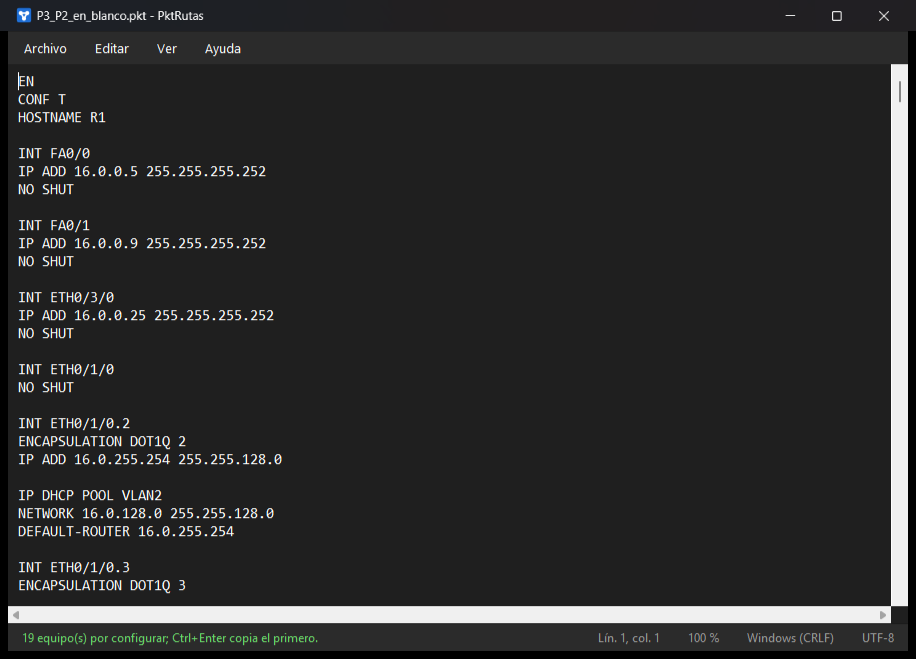
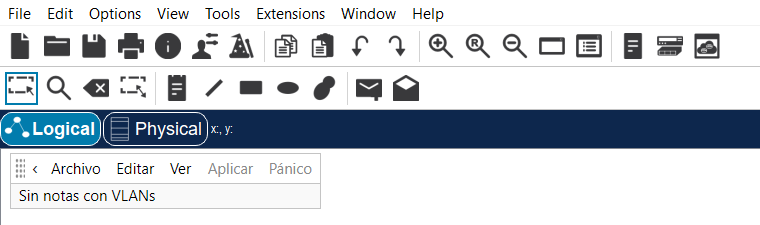
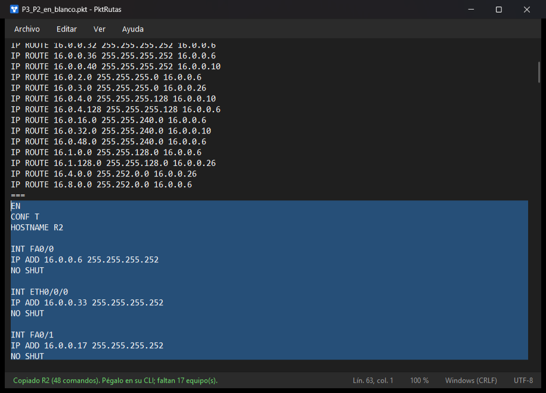

# PktRutas

Genera la configuración Cisco de tus prácticas de Packet Tracer. Lee el `.pkt`
y saca lo que le falta: hostnames, enlaces /30, ruteo estático, VLANs, SVI o
subinterfaces, DHCP, troncales, EtherChannel y la raíz de STP. Si la práctica
está en blanco, la configura completa con lo que pones en el lienzo: el nombre
de cada equipo, las notas de los enlaces y las notas con las redes y VLANs.

La ventana es como el Bloc de notas: abres la práctica y la hoja se llena con
los comandos de cada equipo, listos para pegar en su CLI. También guarda una
copia del `.pkt` con todo ya aplicado, para abrirla en Packet Tracer (8.2 a
9.x).

También viene como módulo dentro del propio Packet Tracer, que además revisa tus
cálculos antes de aplicarlos.



## Dentro de Packet Tracer

`modulo/PktRutas.pts` es el programa como módulo de Packet Tracer 9: corre dentro
de Packet Tracer, sin Python y sin guardar el archivo. Lee la práctica que tienes
abierta, revisa tus cálculos y aplica los comandos directo en cada equipo.



Es una barra chica dentro del lienzo, en blanco como los menús de Packet Tracer:
**Archivo, Editar, Ver**, y a la derecha el modo (**Activo**), **Aplicar** y **Pánico**. No tiene
ventana propia: se va con Packet Tracer y no tapa otras aplicaciones. Se mueve
arrastrándola del asa de la izquierda. La flechita de junto la colapsa hasta dejar
sólo el asa; con un clic en el asa se vuelve a abrir.

Los comandos y los errores se abren en el Bloc de notas. Pasa solo al abrir una
práctica, si hay algo que mostrar; si cambias las notas, **Archivo > Volver a cargar**
(F5). Lo demás sale un momento en un renglón debajo de la barra: cuántos equipos
faltan, cuántos copiaste, cuántas PCs ya tienen IP.

| Atajo, con la barra en foco | Qué hace |
| --- | --- |
| `F5` | Volver a leer la práctica y abrir lo que haya |
| `Ctrl+R` | Los problemas, en el Bloc de notas |
| `Ctrl+Mayús+C` | Copiar todos los equipos |
| `Ctrl+S` | Guardar los comandos en un archivo |
| `Ctrl+Mayús+S` | Aplicar a los equipos |
| `Ctrl+Q` | Cerrar la barra; se vuelve a abrir en **Extensions → PktRutas** |

**Para instalarlo**, una vez en cada computadora:

1. En Packet Tracer: **Extensions → Scripting → Configure PT Script Modules...**
2. **Add** y elige `PktRutas.pts`. Déjalo en una carpeta fija: Packet Tracer
   guarda esa ruta.
3. Selecciónalo en la lista, **Start** y **Ok**.

De ahí en adelante arranca con Packet Tracer y se abre en **Extensions →
PktRutas**.

**Las notas.** Cada router lleva una nota con su nombre, sus VLANs con su diagonal
y, debajo de cada una, tus combos: en IPv4 la red, la última utilizable (la puerta
de enlace) y la máscara; en IPv6 la red y la última, con su diagonal.

```
R1

VLAN 2/22
    11.0.4.0 - 11.0.7.254 - 255.255.252.0
    ABCD:AB:AC:AD::4A0/126 - ABCD:AB:AC:AD::4A3/126

VLAN 3/28
    11.0.0.16 - 11.0.0.30 - 255.255.255.240
    ABCD:AB:AC:AD::16A0/125 - ABCD:AB:AC:AD::16A7/125
```

En IPv6 basta con la red y su diagonal, pero si escribes también la última, el
programa la revisa. Los enlaces van como siempre, con su nota junto al cable
(`.4`). Su IPv6 sale sola, el primer /127 libre de esa misma red: `::` para R1 y
`::1` para R2; para pedir otra, escríbela en la nota: `.4 ABCD:AB:AC:AD::8/127`.

**Qué revisa.** De cada combo se revisa que cuadre con su diagonal (que el bloque empiece
donde debe, y el rango y la máscara), que no se encime con otra red o con un enlace, y que
no se aleje más de un bloque de donde le toca por la cuenta.

* **Si pasa:** se aplica todo, tal como lo escribiste. Desplazado un solo bloque no es un
  error y las demás redes no se recorren; al pie de los problemas se dice qué le tocaba:

  ```
  r4 vlan 5 (16.8.0.0/15) va desplazada, le tocaba 16.6.0.0: se dejó donde la escribiste
  ```

* **Si no:** en IPv4 se reserva el DHCP de esa red; en IPv6, su dirección y sus
  rutas. Lo demás sí se aplica, con los valores correctos. Se abre el Bloc de notas
  con el problema, y si tu red cae encima de otra o de un enlace, dice de cuál:

  ```
  r1 vlan 3: saltos erróneos, es 11.0.0.16 - 11.0.0.30, con máscara 255.255.255.240
  r4 vlan 3: se encima con r2 vlan 3 (16.0.8.0/22), es 16.0.16.0 - 16.0.19.254, con máscara 255.255.252.0
  ```

Si la diagonal del título no cuadra con tu rango y tu máscara, y esos dos sí cuadran
entre sí (`VLAN 5/16` con `16.4.0.0 - 16.5.255.254 - 255.254.0.0`), se usa la de tu
rango y el Bloc de notas lo dice. Si tampoco cuadran entre sí, manda el título.

**La cuenta.** Lo que le toca a cada red, y las que no traen combo, sale como en una hoja:
una tabla por VLAN, de la red más chica a la más grande (primero los enlaces), tachando
los bloques que chocan con lo ya repartido. En cada tabla van por número de router, y el
multicapa ocupa el lugar del router del que cuelga: SWR1 (de R1), R2, R3, R4, SWR3 (de
R5)... Si tus combos o lo ya configurado siguen otro orden, usa el que más coincida y lo
dice.

**Si olvidaste un combo,** no renumeres: agrégalo contando desde tu último combo. Si tu
última red termina en `16.11.255.255`, una `VLAN 6/28` va en `16.12.0.0 - 16.12.0.14`.
Ahí el margen de un bloque se cuenta desde la red que tiene abajo. Una VLAN con diagonal y
sin combo también va después del último, si tus combos no le dejaron lugar en su tabla.

Una nota puede ir a nombre del router aunque la LAN cuelgue del multicapa pegado a él:
`R3` se aplica a `SWR2` si R3 no tiene LAN propia y SWR2 no tiene su nota.

Corrige la nota, **Archivo > Volver a cargar** (F5) y **Aplicar**: entra lo que faltaba.

**Si la práctica quedó a medias o mal hecha,** las notas siempre mandan:

* **Lo que falta se agrega.** Un equipo sin tocar o cortado a la mitad sólo recibe lo que le
  falta, y lo demás que tenga se queda.
* **El equipo que traiga algo que contradiga a las notas se borra y se vuelve a configurar.**
  Su bloque empieza con los `NO ...` y sigue completo; el Bloc de notas dice qué tenía mal.
  Cuenta como mal: una IP, máscara o IPv6 que no es la de la nota (también en un enlace que
  funciona: se pasa al /30 de su nota), una interfaz encima de la red de una VLAN o de un enlace,
  una subinterfaz, SVI o puerto apagados, un puerto con otra VLAN o en otro modo, una troncal que
  no deja pasar una VLAN de su red, un EtherChannel sin troncal, con modos que no se entienden o
  a medias, una ruta por donde el tráfico no llega, un pool que no es el de su VLAN, un
  `excluded-address` que deja sin direcciones a las PCs, `no service dhcp` y la prioridad de STP
  fuera de la raíz.
* **Con más de la mitad de los equipos mal se borran todos.** Para forzarlo aunque nada se vea
  mal: **Archivo > Borrar todo y aplicar**, eligiéndolo dos veces.

Al borrar se va todo lo de red: IPs, rutas, pools, VLANs que su red no lleva, OSPF y demás, ACL y
NAT. Se quedan las contraseñas, el banner y las consolas, porque las notas no dicen nada de eso. Un
equipo sin errores no se toca, así que lo que le hayas tecleado de más (una VLAN nativa, por
ejemplo) sigue ahí.

Al terminar, las PCs del equipo al que se le puso su pool piden DHCP otra vez, y también cualquiera
que siga con una IP o una puerta que no son las de su VLAN. Si alguna no queda bien, el Bloc de
notas dice cuál.

Lo que no se puede saber: si intercambias los hostnames de dos routers, la nota le toca al que trae
ese nombre; y si una PC no dice su VLAN en el nombre, se le cree al puerto mientras esa VLAN
aparezca en alguna nota.

**Los modos de Aplicar.** El botón junto a **Aplicar** dice el modo y, con un clic, deja elegir
otro. **Activo** es lo de siempre: completa todo el ejercicio. Los **pasivos** sólo tocan lo que tú
ya empezaste: cada router o core tiene que traer lo que pide el modo, y entonces se configura
completo, igual que en activo, junto con los switches que cuelgan de él. Al que no cumple no se le
toca nada: ni se borra, ni se le agrega, ni a sus PCs se les pide DHCP.

| Modo | Qué tiene que traer cada router o core |
| --- | --- |
| Activo | Nada: se hace todo |
| Pasivo estricto | Su DHCP y sus enlaces /30, completos y bien |
| Pasivo medio | Sus enlaces /30, completos y bien (el DHCP lo pone Aplicar) |
| Pasivo bajo | Algo de red puesto por ti: una IP, un pool o una ruta |

"Bien" es lo que dicen las notas: un pool por cada VLAN, con su red, su máscara y su puerta, y cada
enlace en el /30 de su nota. Un enlace apagado sí cuenta (Aplicar lo enciende); el hostname solo no
cuenta como empezar, porque puede venir puesto. En un modo pasivo el botón se pinta de amarillo, el
aviso dice cuántos no cumplen, y el Bloc de notas de problemas empieza con qué le falta a cada uno.
Lo inalámbrico va con el sitio de su controladora. El modo se queda guardado: sigue igual al volver
a abrir Packet Tracer.

**Lo inalámbrico.** Si hay una controladora (WLC-3504) cableada, además de las notas de siempre
van dos más. Una lista con el nombre de cada VLAN, sin nombre de equipo; la que se llama `NATIVA` es
la red de la controladora y los AP:

```
VLAN 2/17
ALUMNOS

VLAN 3/22
DOCENTES

VLAN 6/28
NATIVA
```

Y las redes que da cada AP, con el nombre que tiene en el lienzo. Un AP sin nota da todas las de su
sitio, y el Bloc de notas lo dice. `ALUMNO` en esta nota y `ALUMNOS` en la lista de nombres cuentan como
la misma red, y también se dice:

```
AP1
ALUMNOS
DOCENTES
```

La nativa puede ir en el mismo router que las demás VLANs (como `P3_P3`), en un router con su
propia nota y un segundo cable al multicapa (como `P4_P3`; ese segundo cable no lleva IP: es una
troncal) o en la nota del propio multicapa (como `O5_P3`). La controladora y el server van cableados
directo al switch core. Con eso, **Aplicar** pone:

* **La puerta de la nativa y su pool (`VLANNATIVA`):** en un router, la subinterfaz
  `encapsulation dot1Q n native`; en un multicapa, su `interface Vlan n`.
* **La puerta del server:** su red es siempre una `192.168.x.0/24` propia: la `.254` es de la puerta y la
  `.1` del server. Si ya trae una red `192.168.x`, se respeta; cualquier otra se cambia. Dónde queda la
  puerta depende de su cable:
  * En un core multicapa, en ese mismo puerto: `no switchport` y su IP. Las rutas salen solas.
  * En un core que sólo hace de switch (el 3650 de `P3_P3`), que no puede llevar IP en un puerto: una
    VLAN propia (`192 SERVIDOR`, o la siguiente libre), su puerto de acceso y una subinterfaz en el
    router, sin pool. Va al pie de los problemas como supuesto.
  * Si sigue cableado al router, en el puerto del router.

  Si mueves el cable después de aplicar, lo que quedó en el lugar de antes se quita: la IP del puerto
  sin cable y la ruta que ya sobra.
* **Switches:** toda troncal de ese sitio lleva `switchport trunk native vlan n`, también las de los
  AP, la de la controladora y el segundo cable. La PC pegada al switch de la controladora y más
  cercana a ella queda en la nativa: es la que entra al portal.
* **Server:** IP fija, AAA encendido y RADIUS en el puerto 1812, con su cliente en la IP de la
  controladora. Nombre del cliente, secreto, usuario y contraseña son `majli`.
* **Controladora:** nombre `WLC` y portal con `admin` / `Abc1234`. Su IP es la penúltima de la nativa
  (una antes de la puerta). Lleva una interfaz por VLAN, también en su penúltima, y una red
  WPA2-Enterprise AES por VLAN, contra el server. La red `WLC` que pide el asistente del portal queda
  creada, sin darla a los AP.
* **AP:** su puerto de cable pide IP por DHCP, que de fábrica no lo hace, y dan las redes de su nota.
* **Teléfonos:** cada uno con la red de su AP más cercano, turnándose para que cada red tenga alguno,
  con `majli` / `majli`. Si su nombre dice una red, ésa.

La controladora no tiene consola, así que eso no sale como comandos: va al pie de los comandos en el
Bloc de notas, por si quieres verlo, pero no se copia. Para ponerlo, el módulo lo escribe en la
práctica y la vuelve a abrir desde memoria: los equipos reinician con su configuración, y los
teléfonos tardan cerca de un minuto en conectarse. El archivo no se toca hasta que guardes.

**Pánico.** El botón se habilita cuando más de la mitad de los combos están mal.
Corrige en las notas sólo los errores pequeños, los que se justifican con el mismo
combo (la red bien con la última o la máscara mal, o un salto de diferencia),
empezando por los más chicos, hasta llegar al 70% de combos bien, y aplica. Con 8
combos eso es 6 (75%). Los errores grandes no los toca, y el Bloc de notas dice qué
corrigió y qué falta.

Si una PC no dice su VLAN en el nombre (`PC1 V3`), en el switch ni por su IP, se
reparten por orden de puerto, en partes iguales y las primeras VLANs con las que
sobren: con 3 PCs y 2 VLANs, Fa0/2 y Fa0/3 van en la VLAN 2 y Fa0/4 en la VLAN 3.
Contando todos los switches de ese router, cada VLAN de su nota se queda con al
menos una PC; si no alcanzan, el Bloc de notas dice cuál se quedó sin ninguna.

## Instalación

Necesitas Windows y [Python 3.10 o más nuevo](https://www.python.org/downloads/),
instalado con las opciones que trae marcadas (incluyen tkinter, la ventana).

1. Descarga el `PktRutas-x.y.z.zip` de la versión más nueva, en
   [Releases](https://github.com/QuesitoOaxaca21/PktRutas/releases/latest).
2. Clic derecho sobre el zip → **Extraer todo**.
3. En la carpeta que sale, doble clic en **`Instalar.bat`**.

Queda en el menú Inicio, en el escritorio y en el menú **Enviar a**: clic
derecho sobre un `.pkt` → Enviar a → PktRutas lo abre ya analizado. Se instala
sólo para tu usuario, sin permisos de administrador. Para actualizar, corre el
`Instalar.bat` de la versión nueva; para quitarlo, **Configuración →
Aplicaciones → PktRutas → Desinstalar**.

Si prefieres no instalarlo, dentro de la carpeta descomprimida da doble clic en
`Analizar.bat` (o arrastra un `.pkt` encima).

> **¿Por qué un `.bat` y no un `.exe`?** Windows 11 bloquea los `.exe` sin firma
> digital (Control inteligente de aplicaciones) y SmartScreen los marca como
> peligrosos. El instalador y el programa corren con el Python de python.org,
> que sí viene firmado, así que Windows los deja pasar.

## Uso

### 1. Prepara la práctica en Packet Tracer

1. Arma la topología y cablea. Cámbiale el nombre en el lienzo a cada router,
   core y switch (`R1`, `SWR1`, `sw10`); dentro de los equipos no hace falta
   configurar nada.
2. Junto a cada cable entre routers y cores pon una **nota** (Place Note, tecla
   `N`) con su /30: `.4`, `.8`, `.12`...
3. Junto a cada red pon una nota con el nombre de su router o core, su **red
   base** y la diagonal de cada VLAN:

   ```
   R1 16.0.0.0
   VLAN 2/17
   VLAN 3/24
   VLAN 4/25
   ```

4. A cada PC ponle su VLAN en el nombre: `PC1 V3`, `V4 PC2`, `PC7 VLAN5`.
5. Guarda (`Ctrl+S` en Packet Tracer).

Lo que ya hayas configurado a mano se respeta y sólo se genera lo que falta:
si los hostnames y los enlaces ya están puestos, los pasos 1 y 2 sobran.

### 2. Ábrela en PktRutas

**Archivo → Abrir .pkt** (`Ctrl+O`). La hoja se llena con los comandos de cada
equipo, en el orden en que conviene configurarlos (routers, cores y switches),
con el estilo de las prácticas: en mayúsculas, sin comentarios y con `===`
entre un equipo y otro.

```
EN
CONF T
HOSTNAME R2

INT FA0/0
IP ADD 12.0.0.6 255.255.255.252
NO SHUT

INT FA0/1
IP ADD 12.0.0.9 255.255.255.252
NO SHUT
===
EN
CONF T
HOSTNAME R3
...
```

Los nombres que tú pusiste (el hostname, el de una VLAN) se respetan tal cual:
`HOSTNAME sw10` y no `SW10`, para no renombrar el equipo. Si ya configuraste
algo, en la hoja sólo sale lo que falta; si no falta nada, sale la
configuración completa de cada equipo.

La barra de abajo dice cuántos equipos hay por configurar y si hay errores o
avisos; el detalle está en **Ver → Reporte completo** (`Ctrl+R`), que se abre
en el Bloc de notas con el plan de VLANs, la revisión y el detalle del ruteo.

### 3. Copia los comandos o guarda el .pkt configurado

`Ctrl+Enter` (**Editar → Copiar siguiente equipo**) copia el bloque del
siguiente equipo, lo deja seleccionado en la hoja y la barra dice de quién es
y cuántos faltan; lo pegas en su CLI. Como en el Bloc de notas, también puedes
seleccionar a mano, cambiar algo antes de copiar o guardar todo como `.txt`
(`Ctrl+S`).



O **Archivo → Guardar .pkt configurado** (`Ctrl+Mayús+S`): escribe una copia de
la práctica con todo ya aplicado, como si hubieras pegado los comandos. El
original no se toca.

La guía completa, con capturas y qué hacer si algo no sale, viene en
`GUIA.html`; en el programa, **Ayuda → Guía de uso**.

## Las notas, a detalle

### El nombre de cada equipo

El hostname sale del nombre que el equipo tiene en el lienzo (Config → Display
Name), siempre que todavía tenga el de fábrica (`Router` o `Switch`): `R1` en
el lienzo da `hostname R1`. Así las notas, el reporte y la CLI hablan del mismo
equipo.

* Un hostname que ya configuraste no se toca.
* Los nombres que Packet Tracer pone solo (`Router0`, `Switch3`,
  `Multilayer Switch1`) no se usan.
* Los espacios se vuelven guiones (`Router Central` → `Router-Central`) y
  tiene que empezar con letra; si no se puede, el reporte lo avisa.

### Las notas de enlace

Cada cable entre routers y cores toma su /30 de la nota que tenga más cerca
(a menos de unos 200 px del centro del cable):

* Se escribe `.4`, `.4/30`, `16.0.0.4` o `16.0.0.4/30`. La nota dice el /30
  que contiene esa dirección, así que `.4`, `.5` y `.6` dicen lo mismo: hay
  prácticas con cada costumbre.
* La IP más baja va al router (los routers antes que los cores) y, entre dos
  del mismo tipo, al de menor nombre: R1 .5, R2 .6. En el core, el puerto
  sale con `no switchport`.
* Los tres primeros octetos salen de tus enlaces ya configurados. En una
  práctica en blanco, de la nota que traiga la dirección completa
  (`12.0.0.4`), y si ninguna la trae, de la red base de las notas de VLAN. Si
  tus enlaces van en una red distinta a la de las VLANs, o la práctica no
  tiene VLANs, escribe completa al menos una nota.
* Un cable sin nota toma el primer /30 libre desde la .4, y el reporte lo
  avisa por si tu práctica pide otro.
* Si dos notas caen en el mismo /30, se queda con él la que dice su inicio (`.44`
  le gana a `.47`) y la otra toma el primero libre; el aviso dice quién lo usa.
* Entre dos cores el cable se configura sólo si tiene su nota: sin ella
  puede ser una troncal a propósito.
* Los enlaces se resuelven antes que las VLANs, así que las redes de las
  VLANs nunca los pisan.

Si en los enlaces que ya traen IP la mayoría de las notas no coincide con su
/30, en esa práctica las notas significan otra cosa y no se usan. Una nota que
no coincide con su enlace ya configurado se avisa, pero no se cambia nada.

### Las notas de VLANs

Cuatro formas, y se pueden mezclar:

* **La red base y la diagonal de cada VLAN** (VLSM), como en el ejemplo de
  arriba. Sin diagonal en la base, se reparte desde esa dirección dentro de
  la red de su clase (16.0.0.0 → /8). Si varias redes traen la misma base,
  se reparten una tabla por VLAN, de la más chica a la más grande.
* **Sólo la red base** (`R1 16.1.0.0/16`): se reparte en partes iguales entre
  las VLANs de las PCs de esa red (2 VLANs, mitades; 3 o 4, cuartos). Si
  algo de la práctica ya ocupa parte de la base, las partes se achican hasta
  caber y el reporte lo avisa.
* **La red base y cuántos equipos lleva cada VLAN**: VLSM igual que con la
  diagonal (`VLAN 3 500`, `VLAN 4 VENTAS 120`); a cada VLAN le toca el bloque
  más chico donde quepan sus equipos más la red y el broadcast.
* **La red de cada VLAN**, escrita por ti:

  ```
  SWR1
  VLAN 3 12.1.0.0/16
  VLAN 4 12.4.0.0 255.252.0.0
  VLAN 5 CINCO 12.0.0.128/25
  ```

Cada VLAN toma el primer bloque libre desde la base, saltándose lo que ya usa
la práctica (los enlaces, otras VLANs); el orden en que las escribas no importa.
Con diagonales se hace una tabla por VLAN, de la más chica a la más grande, y en
cada tabla por número de router, con el multicapa en el lugar del router del que
cuelga. Si la práctica ya trae redes configuradas en otro orden, se respeta el que
más les coincida, para no moverlas. Con usuarios en vez de diagonales es el VLSM de
siempre: sitio por sitio, de la VLAN más grande a la más chica. Si la lista de la nota
trae VLANs, esa lista manda sobre las PCs. El pool de DHCP de cada VLAN sale de la
misma cuenta que su SVI o subinterfaz, así que su `default-router` siempre es la IP
de esa interfaz.

Al escribir una red:

* Con diagonal (`12.1.0.0/16`), con máscara completa (`12.4.0.0 255.252.0.0`)
  o con tu estilo de siempre: `VLAN 2` en un renglón y abajo
  `red - broadcast - máscara`, con la máscara abreviada (`255.192`, `252.0`,
  `.248`) o las direcciones recortadas (`3.0 - 3.255 255.0`; los octetos que
  faltan se toman de los enlaces /30).
* El nombre de la VLAN es opcional; si no lo pones se usa el número en letra
  (`VLAN 3` → `TRES`), como en las prácticas.
* La puerta de enlace es la **última dirección utilizable**. Para otra, agrega
  `gw 12.1.0.1` en el renglón.
* Una sola nota puede describir varios sitios: cada renglón con un hostname
  abre un sitio nuevo.
* Tolera erratas comunes (`17.1.128..0`) y avisa cuando la máscara no cuadra
  con el rango, en vez de adivinar en silencio.

Las notas de enlace no estorban a las de VLANs: como plan de VLANs sólo se
leen las notas que traen un hostname con red o la palabra VLAN.

### De qué equipo es cada nota de VLANs

Se decide así, en orden: por el **hostname** escrito en la nota; si no trae,
porque sus redes **ya están configuradas** en algún equipo; y si tampoco, por
**cercanía** en el lienzo. La cercanía falla con facilidad, así que cuando se
usa el reporte lo avisa para que agregues el nombre.

## Qué genera y qué corrige

### Qué genera

* **Hostnames y enlaces**: del nombre en el lienzo y de las notas de enlace.
* **Core multicapa**: `ip routing`, las VLANs, una SVI y un pool de DHCP por
  VLAN, y las troncales hacia sus switches (con `encapsulation dot1q`).
* **Router** (router-on-a-stick): `no shutdown` en el puerto hacia el switch,
  una subinterfaz `encapsulation dot1Q` por VLAN y su pool de DHCP.
* **Switches del sitio**: las VLANs con nombre, las troncales, EtherChannel en
  los cables paralelos, la raíz de STP y un puerto de acceso por PC.
* **Ruteo estático** en todos, ya con las redes de las VLANs.

Dos reglas salen de cómo se resuelven estas prácticas a mano:

* **Raíz de STP**: el switch pegado al core o al router, sólo si el sitio
  tiene switches colgados de otros. Se pone la prioridad 4096 sólo para la
  VLAN 1, como en las prácticas: con PVST cada VLAN elige su raíz aparte, así
  que en las demás la decide la MAC más baja.
* **EtherChannel**: dos o más cables entre los mismos dos switches. `active`
  el más cercano al core, `passive` el otro.

Lo que ya tengas puesto no se repite en "Comandos por aplicar"; en
"Configuración completa" sale todo.

### Qué corrige solo

En los enlaces /30 revisa cada cable entre routers y cores:

* **IP que es de otro enlace**: si un extremo tiene una IP que ya es de otro
  equipo, o cae en la red de otro enlace, la cambia por la que le toca junto a
  su vecino.
* **Máscara distinta** a la del vecino: la iguala a la de tus enlaces.
* **La misma IP en los dos extremos**: al de menor nombre le deja la más baja.
* **Un extremo sin IP**: lo completa con la otra dirección del /30 (en un core,
  con `no switchport`).
* **Cable sin IP en ningún lado**: toma el /30 de su nota o, sin nota, el
  primero libre desde la .4 de tus enlaces, sin pisar ninguna red, y te lo
  dice por si tu práctica pide otro.
* **Puerto con IP pero apagado**: agrega `no shutdown`.
* **Las dos IPs en redes distintas, sin nada que diga cuál está mal**: decide
  la nota del enlace; sin nota, se queda la red del primer equipo (el router
  antes que el core, R1 antes que R2) y se avisa.

El arreglo va en los comandos de ese equipo, y el ruteo se calcula ya con la
red corregida; el detalle de cada cambio está en el reporte.

En las notas corrige erratas (`17.1.128..0`), la máscara que no cuadra con el
rango o la diagonal, la dirección que no es de red y la puerta de enlace fuera
de la red, y avisa cada vez. Lo que no corrige son dos VLANs que se enciman:
no hay forma de saber cuál querías mover, así que dice cuáles chocan.

### Si la práctica quedó a medias o mal hecha

Ábrela tal cual. Lo que falta se completa, y lo que el mismo comando reemplaza
se corrige solo: la IP de una SVI o subinterfaz, la VLAN de un puerto, el
nombre de una VLAN, un enlace mal tecleado.

Hay errores que no se quitan agregando comandos. El equipo que tenga alguno
**se rehace desde cero**: su bloque empieza con los `NO ...` que borran lo que
el programa configura (rutas, pools, prioridades de STP, subinterfaces, SVI,
EtherChannel e IPs de los puertos) y sigue con su configuración completa, ya
correcta. Lo demás que tenga (contraseñas, ACL, NAT...) no se toca. Esos
errores son:

* una ruta estática por la que el tráfico no llega (da vueltas o se pierde).
  Una que llega por un camino más largo, como en un anillo, se respeta;
* un pool de DHCP que cubre la red de una VLAN y no es el de esa VLAN;
* un EtherChannel que no se forma (puntas en modos que no se entienden, o
  puertos del mismo canal en grupos o modos distintos), o en puertos que no
  van en canal. Con PAgP (`desirable` / `auto`) también se forma;
* una prioridad de STP que le compite a la raíz de su red (4096 o menos);
* en un router-on-a-stick: una IP suelta en el puerto de las subinterfaces,
  una SVI con IP o una subinterfaz con la VLAN cambiada.

La barra de estado dice qué equipos se rehacen y el reporte (`Ctrl+R`), por
qué. El `.pkt` configurado hace lo mismo: limpia esos equipos y los vuelve a
armar.

### El .pkt configurado

La copia lleva hostnames, enlaces, ruteo, VLANs, SVI o subinterfaces, DHCP,
troncales, EtherChannel, STP, puertos de acceso y las correcciones de los
enlaces. Las PCs del plan quedan en DHCP y recuperan su nombre original
(`PC1 V3` queda como `PC1`), porque en la copia la VLAN ya vive en el puerto
del switch; si dos quedarían con el mismo nombre, la segunda se deja igual y
se avisa. Por omisión se llama `<práctica>_configurado.pkt`, y antes de
guardarla el programa la vuelve a leer para comprobar que ya no le falte nada.

El programa lee el archivo como está guardado en disco: si tienes cambios en
Packet Tracer, guárdalos antes.

## La ventana

Es como el Bloc de notas de Windows 11, y sigue su tema claro u oscuro: la
barra de menú (**Archivo, Editar, Ver, Ayuda**), la hoja con los comandos y la
barra de estado con el mensaje, la línea y columna, el zoom, el fin de línea y
la codificación. La hoja se puede editar, deshacer, acercar o alejar y ajustar
al ancho de la ventana, como en el Bloc de notas. Se mueve con la rueda del
mouse o el touchpad; las barras de desplazamiento son delgadas, como las de
Windows 11: se asoman al mover el puntero y se esconden solas. Ningún error
cierra el programa: se avisa en la barra de estado, en rojo.

| Tecla | Acción |
|---|---|
| `Ctrl+O` | Abrir una práctica (`.pkt`) |
| `F5` | Volver a cargarla, después de guardar cambios en Packet Tracer |
| `Ctrl+Enter` | Copiar el siguiente equipo |
| `Ctrl+S` | Guardar los comandos como `.txt` |
| `Ctrl+Mayús+S` | Guardar el `.pkt` configurado |
| `Ctrl+R` | Ver el reporte completo, en el Bloc de notas |
| `Ctrl+Mayús+C` | Copiar todos los comandos |
| `Ctrl+Más` / `Ctrl+Menos` / `Ctrl+0` | Acercar / alejar / restaurar el zoom |
| `Ctrl+Q` | Salir |

## Más detalles

Cómo calcula el ruteo, de dónde saca la configuración del `.pkt`, cómo escribe
la copia configurada, cómo funciona el instalador, la estructura del código y
las pruebas: [`docs/TECNICO.md`](docs/TECNICO.md).

PktRutas sólo usa la biblioteca estándar de Python, incluido el descifrado del
`.pkt` (Twofish implementado desde cero).
